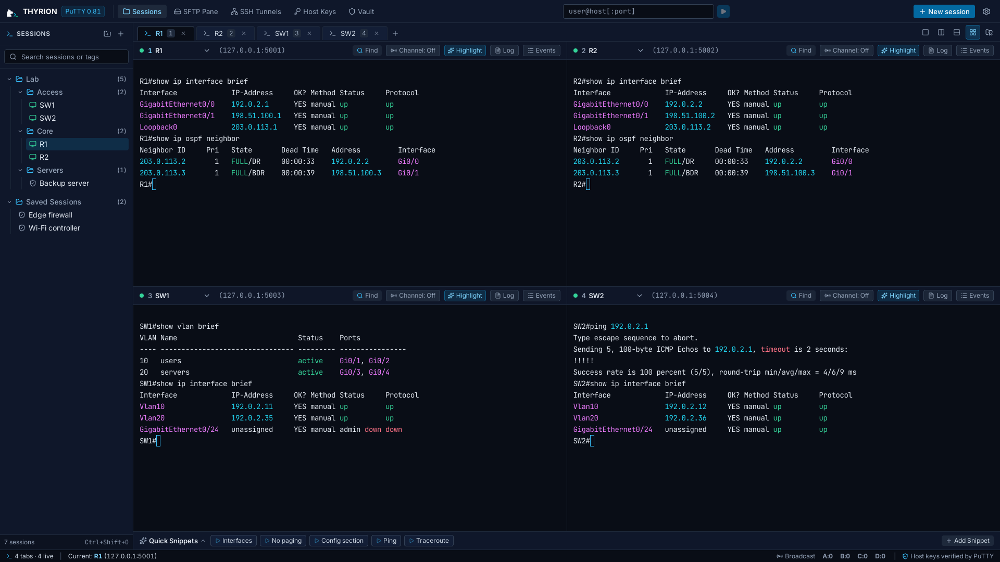
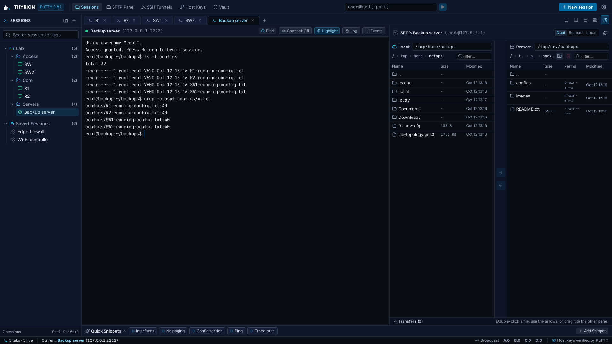
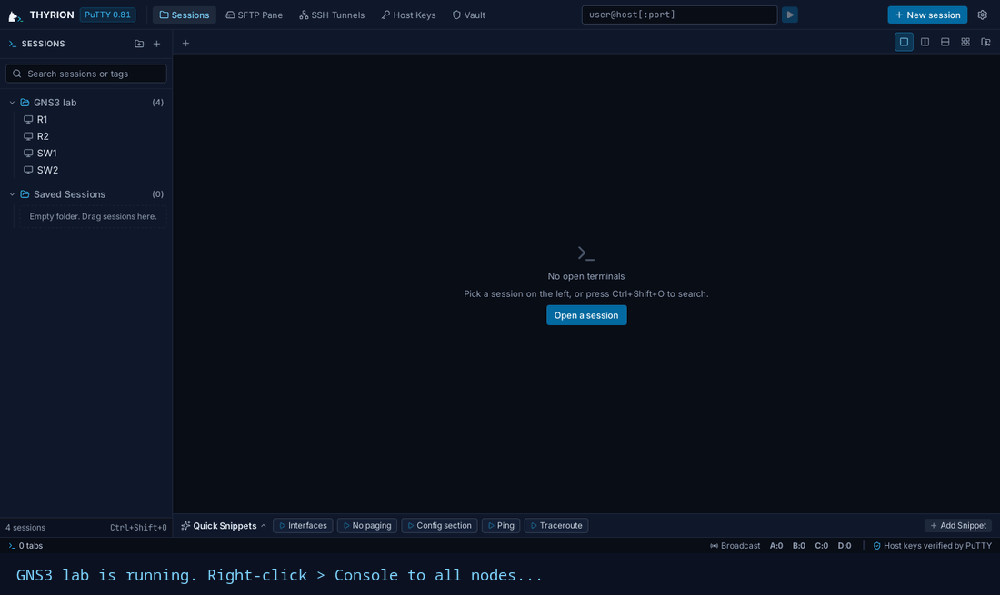

# Thyrion

**A desktop terminal and session manager built on PuTTY.**

Thyrion is for system administrators, network engineers and anyone who works
over SSH, telnet or serial consoles. PuTTY's own tools make the SSH
connections and transfer the files; Thyrion adds tabs, split screens, a file
browser, a password vault and a few everyday time-savers.

It uses the sessions you have already saved in PuTTY, so there is nothing to
import. Sessions you add or change in Thyrion are saved in the same place, so
PuTTY sees them too.

*Saved sessions in folders on the left, four device consoles side by side.*

*A server's shell next to its files: drag, double-click or use the arrows to
move them.*

*GNS3's "Console to all nodes": each device arrives as a tab in the window
that is already open. Set GNS3's console command to
`thyrion --telnet {host} {port} --title "{name}"`.*

*Thyrion was called Plinky until version 0.2.0. See
[Coming from Plinky](#coming-from-plinky).*

---

## What you can do with it

- **Open your PuTTY sessions in tabs.** The same saved sessions you use in
  PuTTY, organised in folders and subfolders, with tags and search.
- **Work side by side.** Split the window into two or four terminals, with a
  file browser next to your shell.
- **Type into several servers at once.** Group tabs into broadcast channels and
  send one command to all of them.
- **Move files without leaving the terminal.** A two-pane file browser for
  uploads, downloads and remote folders.
- **Keep passwords in an encrypted vault.** Log in automatically, including
  through a jump host, and send network devices their enable password when
  they ask for it. Passwords stay in the vault, not in PuTTY's session files.
  [How your passwords are protected](docs/PASSWORDS.md).
- **Reach hosts behind a gateway.** Connect through a jump host / bastion with
  one setting.
- **Work with network gear.** Serial console sessions with USB adapter
  detection and Send Break, and slow line-by-line paste for devices that drop
  characters.
- **Use it as GNS3's console.** Set GNS3's custom console command to
  `thyrion --telnet {host} {port} --title "{name}"` and every device opens as
  a tab in one Thyrion window.
- **Save time.** Reusable command snippets with fill-in values, highlighted IPs
  and keywords, clickable links, and point-and-click cursor editing.
- **Keep a record.** Log any session straight to a file of your choice as it
  happens.
- **Manage tunnels and host keys** from one place.
- **Make it yours.** Ten interface themes (including a classic light look),
  seventeen terminal colour schemes, and programming fonts built in, so they
  work offline.

---

## Platforms

- **Linux:** AppImage, `.deb` and `.rpm`
- **Windows:** installer and portable `.exe`

macOS is planned for later.

Thyrion uses the PuTTY you already have installed, so install
[PuTTY](https://www.chiark.greenend.org.uk/~sgtatham/putty/) first.

## Download

Get the latest version from the
[Releases page](https://github.com/ArisAlt/Thyrion/releases).

---

## Reporting problems

Bugs and ideas: [open an issue](https://github.com/ArisAlt/Thyrion/issues/new/choose).
Security problems: privately, as described in [SECURITY.md](SECURITY.md).

---

## License

Thyrion is free software under the [GNU General Public License v3.0](LICENSE)
(GPL-3.0-only). You may use, share and change it. If you distribute Thyrion or
a modified version, you must do so under the same license, with its source
code.

For a commercial license, for example to use Thyrion's code in a closed-source
product, contact the maintainer through GitHub.

Versions up to and including 0.1.4 were published under MIT or Apache-2.0;
copies of those versions keep those terms.

---

## Coming from Plinky

Thyrion is Plinky, renamed in 0.2.0. Nothing is lost:

- **Your passwords and settings come along.** On its first start Thyrion
  copies Plinky's vault, snippets, folders, layout and settings into its own
  folder. Plinky's folder is left as it was.
- **Your sessions are where they were**, in PuTTY's own store.
- **Linux:** installing the Thyrion package replaces Plinky's. The commands
  `plinky` and `plinky-desktop` still work and start Thyrion, so a GNS3
  console command written for Plinky keeps working; new ones can use
  `thyrion --telnet {host} {port} --title "{name}"`.
- **Windows:** Thyrion installs as its own app. Point GNS3's console command
  at Thyrion, then uninstall Plinky when you're ready.
- **Scripts** that start with `from plinky import session` keep working;
  new ones can use `from thyrion import session`.

---

## The name, and Alis

Thyrion (Θύριον) was a town in ancient Acarnania, in western Greece. Its name
comes from θύρα, a door, and in networking a *port*: fitting for a tool that
opens doors to consoles and remote machines.

Thyrion's mascot is **Alis**, the maintainer's dog. In memory of a very good
dog.

Developers: see [docs/DEVELOPMENT.md](docs/DEVELOPMENT.md).
